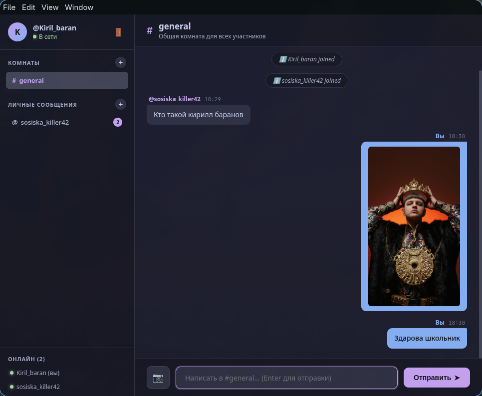

# Wiretalk

**A lightweight, high-performance C++ client-server messaging system built with POSIX TCP sockets, non-blocking I/O multiplexing (`poll`), and a custom JSON-based protocol.**



---

## Overview

**Wiretalk** is an individual school project focused on low-level systems and network programming. The goal was to build a robust, scalable chat backend from scratch in modern C++, implementing real-world patterns such as RAII, move semantics, non-blocking asynchronous event loops, and structured stream framing.

The project features a dedicated C++ server, a C++ CLI client, and a modern cross-platform graphical client powered by Electron.

---

## Key Features

- [x] **Asynchronous I/O Multiplexing:** Powered by Linux `poll()`, allowing the single-threaded server to handle multiple simultaneous clients with virtually zero idle CPU usage.
- [x] **RAII Socket Management:** Custom move-only `Socket` class ensuring automatic cleanup of file descriptors (`close(fd)`) and preventing descriptor leaks or duplicate ownership.
- [x] **Stream Framing & Protocol:** Newline-delimited JSON (`\n`) protocol over TCP, properly handling packet fragmentation, partial reads, and batch packet delivery.
- [x] **Chat Rooms & Channels:** Persistent channel membership (users remain in joined channels across sessions, similar to Telegram/Discord).
- [x] **Direct / Private Messaging:** 1-on-1 messaging with automatic real-time routing for online users and offline storage.
- [x] **Image & Photo Transmission:** Support for sending images encoded as Base64 strings directly in the message payload with dynamic buffer handling up to 10 MB.
- [x] **Persistent Server History:** Automatic persistence of rooms, chat history, registered users, and room memberships to `messages.json`.
- [x] **Cross-Platform UI:** Modern Electron desktop client and native C++ terminal client.

---

## Architecture Highlights

```text
               ┌─────────────────────────────────────┐
               │         Wiretalk Server (C++)       │
               │                                     │
               │   ┌─────────────────────────────┐   │
               │   │    Linux Event Loop (poll)  │   │
               │   └──────────────┬──────────────┘   │
               │                  │                  │
               │       ┌──────────┴──────────┐       │
               │       ▼                     ▼       │
               │  RAII Sockets          Inverted     │
               │  (move-only)           Index Map    │
               │                  (user -> channels) │
               │                                     │
               │   ┌─────────────────────────────┐   │
               │   │    JSON Stream Framing      │   │
               │   └──────────────┬──────────────┘   │
               └──────────────────┼──────────────────┘
                                  │ TCP (Port 5050)
            ┌─────────────────────┴─────────────────────┐
            ▼                                           ▼
   ┌─────────────────┐                         ┌─────────────────┐
   │ Electron Client │                         │  C++ CLI Client │
   │   (GUI / JS)    │                         │   (Terminal)    │
   └─────────────────┘                         └─────────────────┘
```

- **`Socket` wrapper:** Explicit constructor, deleted copy operations (`= delete`), and `noexcept` move semantics preventing double-close bugs.
- **Inverted Indexing:** Two-way mapping (`rooms` and `users_rooms`) for $O(1)$ fast channel queries during user login.
- **Resilience:** Sanitized with `-fsanitize=address,undefined` in Debug builds to eliminate memory leaks and undefined behaviors.

---

## Protocol Specification

Wiretalk uses newline-terminated (`\n`) JSON messages over TCP.

### 1. User Authentication
```json
// Client -> Server
{ "type": "login", "user": "Arseniy" }

// Server -> Client
{ "type": "login_result", "ok": true, "reason": "" }
```

### 2. Room Message (Text & Image)
```json
// Client -> Server
{
  "type": "message",
  "room": "general",
  "message": "Check out this screenshot!",
  "image": "data:image/png;base64,iVBORw0KGgoAAAANSUhEUgAA..."
}
```

### 3. Private Message
```json
// Client -> Server
{
  "type": "private",
  "to": "Vova",
  "message": "Hey, are you online?"
}
```

### 4. Room Management
```json
// Join a room
{ "type": "join", "room": "gaming" }

// Leave a room
{ "type": "leave", "room": "gaming" }

// Request list of user's rooms
{ "type": "rooms" }
```

---

## Technology Stack

- **Backend:** C++ (C++17/20), POSIX Sockets, Linux `poll()`, `nlohmann/json`
- **Memory Safety:** RAII idiom, AddressSanitizer (ASan), UndefinedBehaviorSanitizer (UBSan)
- **Frontend / Client:** Electron, JavaScript, HTML5, CSS3
- **Build System:** GNU Make, GCC / Clang

---

## Building and Running

### Prerequisites
- GCC / G++ supporting C++17 or newer
- GNU Make
- Node.js & npm (for the Electron client)

### 1. Build the Server & CLI Client
```bash
make
```

### 2. Start the Server
```bash
./server
```
*The server listens on `0.0.0.0:5050` by default and automatically creates/loads `messages.json`.*

### 3. Run the Electron GUI Client
```bash
./run-electron.sh
```

### 4. Run the Terminal Client (Alternative)
```bash
./client
```

---

## Academic Context

Wiretalk is an individual school research and engineering project demonstrating practical knowledge of:
1. Low-level networking and TCP socket lifecycles.
2. Resource management (RAII) and move semantics in modern C++.
3. Event-driven non-blocking I/O architectures (`poll`).
4. Modern software design combining a high-performance C++ backend with a user-friendly GUI.
